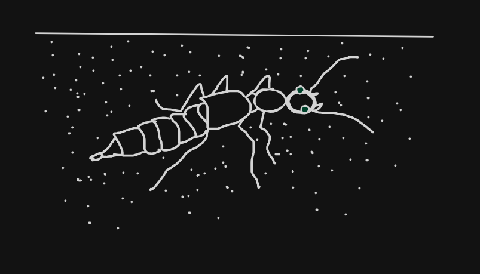

# RoveBeetle



A TypeScript template for publishing a typed client for a set of UTCP tools.
The generator reads a UTCP manual and writes one function per tool, and a
client given the wrong credentials does not compile.

The published client needs Node 22 or later, or Bun 1.4.4 or later.
`npm run generate` needs Node.

> There are known issues regarding the usage of rove beetle on windows. We intend to fix this first, avoid using rove beetle for now till we give the all clear (if you are on windows).

## Start

1. Copy this repository, `git init`, then `npm install`.
2. Edit `rovebeetle.config.ts`. This is all of it:

   ```ts
   export default {
   	// A path, an https URL, or a UTCP manual call template to discover it.
   	manual: "./manual.json",
   	// The protocols this package may speak. No default.
   	protocols: ["http", "sse"],
   	names: { get_forecast: "forecast" }, // optional renames
   	skip: [], // optional tools to leave out
   	// graphql: { depth: 2 }, // required when discovering from GraphQL
   };
   ```

3. Run `npm run generate`, review the diff, and publish under your own name.

```ts
import { getForecast } from "@acme/weather";
import { HttpClient } from "@acme/weather/http";

const weather = new HttpClient({
	variables: { WEATHER_API_KEY: key },
	maxResponseBytes: 1_048_576,
});
const forecast = await weather.call(getForecast({ city: "Oslo" }), {
	signal: AbortSignal.timeout(5_000),
});
```

## Not included

- OpenAPI documents. Use [dung beetle](https://github.com/Smiduweorc/dung-beetle-template).
- Retries and reconnects. Use [Firefly](https://github.com/Smiduweorc/firefly).
- Timeouts. Pass an `AbortSignal` per call.
- Caching. Use [Repletes](https://github.com/Smiduweorc/Repletes).
- Validating arguments and results against the manual's schemas.
- Reading `process.env`. Pass values to the constructor.

## Known quirks

- The `cli`, `tcp`, `udp` and `file` subpaths, and stdio MCP servers, use
  Node's built-in modules, so they do not run in a browser.
- Browsers cannot set headers on a `WebSocket`, so a `websocket` tool with
  header auth only works where the runtime can.
- Discovering a manual can run the commands the config names (`cli`, stdio
  `mcp`). Review the config as you review code.

## Guides

- [Protocols](./guides/protocols.md)
- [Architecture](./guides/architecture.md)
- [Boundaries](./guides/boundaries.md)

Commit messages, hooks and `release.sh` work as described in
[black-garden-ants](https://github.com/Smiduweorc/black-garden-ants).

Licence: ISC.

## Lore

Many rove beetles live as guests in ant and termite nests. They copy the
colony's chemical signals, so the hosts feed them. RoveBeetle speaks whichever
of UTCP's eleven protocols a tool uses.

This project was made for some bun web server and LLM clients.
