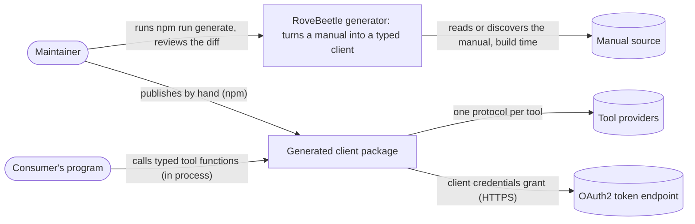
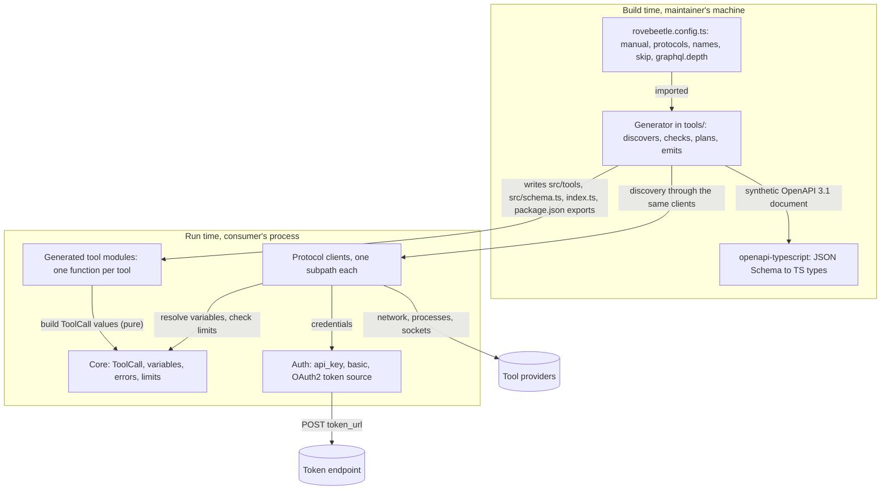
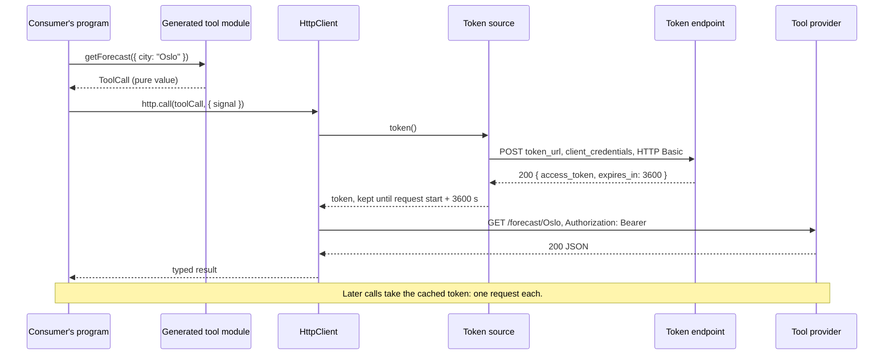
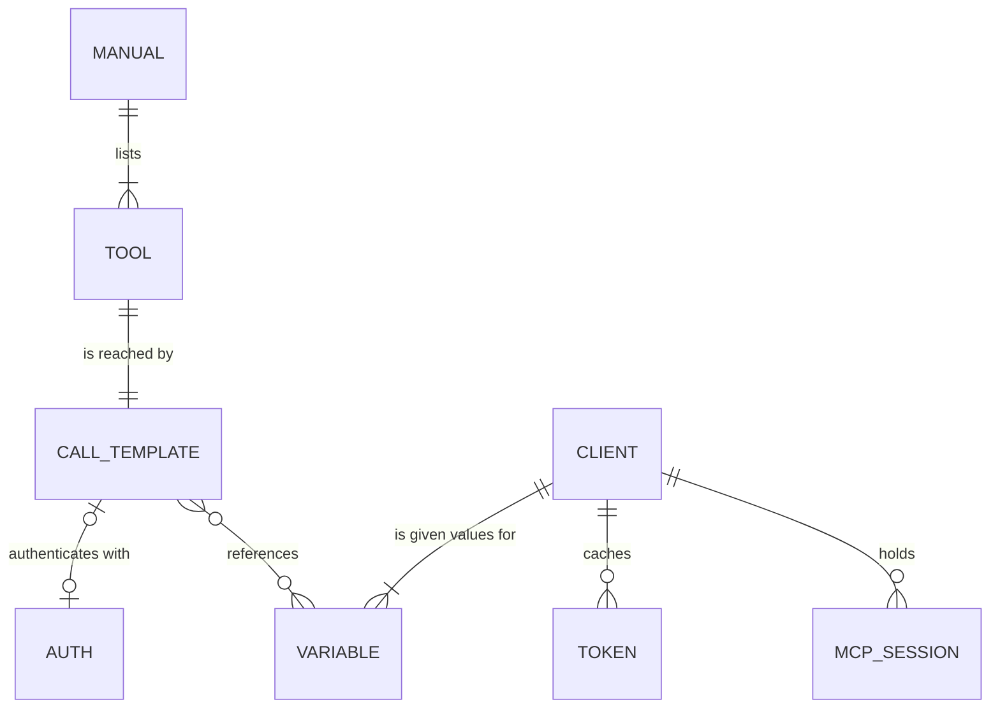
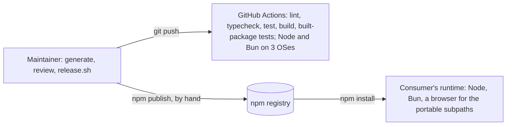

# Architecture

## 1. Problem and context

A UTCP manual describes a set of tools: a name, a JSON Schema for the
arguments, a JSON Schema for the result, and a call template saying how to
reach it (an HTTP request, a shell command, an MCP server, a TCP socket) and
how to authenticate. The available clients read the manual at run time and
call tools by name with untyped arguments, so a renamed tool, a newly required
argument or an auth change from an API key to OAuth2 shows up as a failed call
in production. They also make choices on the caller's behalf that we would
not make; section 14 lists them.

Done looks like this: a maintainer points RoveBeetle at a manual, runs
`npm run generate`, reviews a diff with one typed function per tool, and
publishes it as their own package. A client given the wrong credentials does
not compile. When the manual changes, the next run reports which public names
appeared and disappeared.

## 2. Scope

In scope:

- Reading a UTCP 1.x manual from a file or a URL, or discovering it at build
  time over any of the eleven protocols.
- One typed function per tool, for every call template type in the spec:
  `http`, `sse`, `streamable_http`, `graphql`, `websocket`, `tcp`, `udp`,
  `mcp`, `cli`, `text`, `file`.
- Each template's `auth` (`api_key`, `basic`, `oauth2`) and every `${VAR}` it
  uses, as typed, required client options.
- A runtime client for each protocol, on its own subpath, exported only for
  the protocols the manual's tools use.

Out of scope, and where each goes, is in [Boundaries](./boundaries.md).

## 3. Constraints

- TypeScript, ESM. The published client runs on Node 22 and later and Bun
  1.4.4 and later; the generator runs on Node. CI covers Node 22 and 24 and Bun
  1.4.4 and latest, each on Linux, macOS and Windows.
- No runtime dependencies.
- The root and the `http`, `sse`, `streamable-http`, `graphql`, `websocket`
  and `text` subpaths import no `node:` module. `cli`, `tcp`, `udp` and `file`
  need Node's built-in modules; `mcp` loads `node:child_process` only when a
  stdio server is used.
- The spec is the `python-utcp` pydantic models at bb8e2f6 (2026-10-25) and
  `utcp-specification` at 4a9ed93 (2026-09-16).
- Tooling as in dung-beetle-template: the node test runner through tsx, ESLint
  flat config, lefthook, git-cliff, `release.sh`, publishing by hand.

## 4. Quality goals

Ranked by grml, 2026-11-08.

| Rank | Attribute | Scenario |
| --- | --- | --- |
| 1 | Security | A manual whose strings carry code, quote or comment breakers produces generated code that compiles, runs nothing when imported, and carries each string back unchanged (`tests/attacks/manual.test.ts`). A `cli` argument cannot run a command in any quote context (`tests/attacks/cli.test.ts`). |
| 2 | Correctness of calls | For every field of every call template, a test sends a call through a scripted transport or a real local server and asserts what goes out and what comes back. MCP runs against servers built with the official SDK; GraphQL against `graphql` and `graphql-ws`. |
| 3 | Portability | The built root and each browser-safe subpath reach no `node:` import (`tests/dist`), and the runtime suite passes under Node and Bun. |
| - | Modifiability | Regenerating against a changed manual reports added and removed names (`tests/generator/cli.test.ts`). |
| - | Performance | No benchmarks yet. |
| - | Availability, durability, cost | Not applicable: no service and no stored state beyond in-memory tokens and sessions. |

## 5. Scale

| Quantity | Today | Ceiling designed for | Source |
| --- | --- | --- | --- |
| Tools per manual | 1 to 12 in the spec's examples | 2,000 | GitHub's REST API has 1,220 operations; a manual converted from it is the largest we know of |
| Protocols per package | 1 to 2 | 11 | The spec |
| Manual size | under 10 KB in the examples | 64 MiB, the generator's fixed read limit | GitHub's OpenAPI document is 12.9 MB |

A 2,000-tool manual generates and compiles in the test suite. If the first
large real manual takes long enough to matter, profile `openapi-typescript`
first: it does all the schema work.

## 6. System context



- Manual source: a file, a URL, or whatever a manual call template points at:
  an HTTP endpoint, an MCP server, a GraphQL schema, a command, a socket.
- Tool providers: whatever the tools' call templates point at.

## 7. Containers



| Container | Responsibility | Holds |
| --- | --- | --- |
| Generator | Read or discover the manual, refuse what it cannot generate correctly, name tools, emit modules, report the public diff | Nothing at run time |
| openapi-typescript | Turn each tool's schemas into TypeScript | devDependency |
| Generated tool modules | One function per tool returning a `ToolCall` value with the checked call template | The template, secrets as `${VAR}` |
| Core | `ToolCall`, variable substitution, `RoveError`, response limits | |
| Auth | Apply `api_key` and `basic`; fetch, cache and refetch OAuth2 tokens | One token cache per client instance |
| Protocol clients | Execute a `ToolCall` for one protocol | MCP sessions, per client instance |

## 8. Key scenarios

Happy path, and the highest-volume path after the first call: an `http` tool
with `oauth2` auth.



Scariest failure: the token has expired, two calls arrive at once, and the
token endpoint is slow.

```mermaid
sequenceDiagram
  participant P as Consumer's program
  participant H as HttpClient
  participant A as Token source
  participant T as Token endpoint
  P->>H: call A (signal A)
  P->>H: call B (signal B)
  H->>A: token() for A
  A->>T: one POST, shared by A and B
  H->>A: token() for B joins the pending request
  Note over P,T: No timeout of ours. Each caller's signal bounds its own wait.
  P--xH: signal A aborts
  H-->>P: A rejects with its own abort reason; B keeps waiting
  T-->>A: 500
  A-->>H: RoveError token_request_failed, status 500, body
  H-->>P: B rejects with it. Nothing is cached, nothing is retried.
```

## 9. Data



| Entity | Owner | Lifetime |
| --- | --- | --- |
| Manual, tool, call template, auth | The generator reads them; generated modules hold the templates as literals | Until the next generate |
| Variable | Named by the generated `VariableName` type; values given to a client's constructor | The client instance |
| Client | The consumer, one per protocol, constructed once and shared | Until dropped; `McpClient.close()` ends its sessions |
| Token | The token source inside one client | Until `expires_in` runs out, counted from when the request started; never persisted |
| MCP session | One per server inside one `McpClient` | Until `close()`, the server ends it, or an HTTP session expires |

One process only: two clients fetch two tokens, and twenty replicas twenty.

## 10. Cross-component contracts

| From -> To | Call style | Timeout | Retry owner | When To fails | Consistency |
| --- | --- | --- | --- | --- | --- |
| Config -> generator | import at build time | n/a | n/a | An unknown key stops the run, naming it | n/a |
| Generator -> manual source | build time, over the source's protocol through the runtime's clients | none; Ctrl-C | The maintainer reruns | The run stops, nothing written | Whole manual or nothing |
| Generator -> openapi-typescript | in process | n/a | n/a | The run stops, nothing written | Files are written only after every step succeeded |
| Generator -> generated files | file writes | n/a | n/a | A file without the generator's banner is never overwritten | n/a |
| Generated module -> core | pure | n/a | n/a | n/a | n/a |
| Client -> token source | in process | the caller's signal | none | `token_request_failed` | One pending request per auth block; a failure caches nothing |
| Token source -> token endpoint | HTTPS POST, no redirects | the caller's signal | the caller | `token_request_failed` with status and body | |
| Client -> tool provider | per protocol | the caller's signal; manual timeouts are documented, not applied | the caller (Firefly) | A `RoveError` with code, target, status and body | One call, one attempt |

## 11. Deployment



Released with `release.sh`, published by hand. A bad release is fixed by
publishing the previous code as a new patch.

## 12. Cross-cutting concerns

- Secrets: never in generated code. A `${VAR}` becomes a client option; a
  literal secret in a manual's auth is generated as written, with a warning.
- Errors: one `RoveError` with a `code` from a fixed union. An abort rejects
  with the caller's own reason, unwrapped.
- Limits: every client that buffers takes a required `maxResponseBytes`.
- Environment: nothing in the runtime reads `process.env`. `cli` and stdio
  `mcp` take the environment to inherit from as a required option, filtered by
  the spec's allowlist.
- Observability: none. No logging.

## 13. Decisions

**Build-time generation.** One typed function per tool, written by a
generator the maintainer runs and reviews, as dung beetle does for OpenAPI.
The alternative, `@utcp/sdk`, calls tools by name at run time with untyped
arguments, implements 7 of the 11 protocols, and depends on `axios`, `zod`,
`dotenv` and `js-yaml`.

**Protocols are a required config key, and each is a subpath.** Whether a
package may spawn shells is a trust decision, so `protocols` has no default.
A tool using an unlisted protocol stops the run with a block to paste under
`skip`; a listed protocol nothing uses is an error too. UTCP 1.1 makes the
same decision at run time with `allowed_communication_protocols`, which is
refused in manuals and pointed at the config.

**Variables are typed constructor options.** `${NAME}` and `$NAME` in a
template become a required `variables` entry; the type of a call names the
variables it needs, so a client without one does not accept it. Nothing reads
the environment. Fields that are code for another interpreter or payloads
(`graphql` query, `cli` commands, `websocket` messages, socket request
templates, `text` content) are never substituted; the reference rewrites a
GraphQL `$id` and expands a shell's `$HOME` from its own environment.

**OAuth2 in the runtime.** Client credentials with HTTP Basic client
authentication only (RFC 6749 section 2.3.1: servers must support it), no
fallback that resends the secret elsewhere, no redirects on the token
request, a token kept until `expires_in` after the request started, and not
kept at all without `expires_in`. Concurrent calls share one request. A 401
from a tool is not answered with a refetch and retry; that is a retry.

**Manual timeouts and reconnects are documented, not applied.** They are the
caller's numbers. Each tool's doc comment carries the manual's values; every
call takes an `AbortSignal`.

**Required response limits.** The largest legitimate response is the
caller's number, so `maxResponseBytes` has no default. It bounds bodies,
events, lines, messages, frames and command output, and token responses.

**Redirects stay on the origin.** `fetch` keeps an `X-Api-Key` header or a
query-string key when a redirect leaves the origin, so the client follows
redirects itself, within the origin only, putting a query key back on each
hop. Streaming calls follow none.

**A dependency-free MCP client.** `@modelcontextprotocol/sdk` 1.32.2 brings
`express`, `hono`, `cors`, `ajv`, `jose` and more to every consumer; the
client side of JSON-RPC over stdio and Streamable HTTP is small. The SDK is a
devDependency and the conformance oracle. `isError` results fail;
`structuredContent` is returned as sent; FastMCP's wrapper is unwrapped only
when the output schema carries its `x-fastmcp-wrap-result` marker.

**CLI arguments travel in the environment.** Each placeholder becomes a
reference to a per-call randomly named environment variable written for its
quote context, as the reference does after GHSA-33p6-5jxp-p3x4. Unlike the
reference, each step's exit status is checked and its output streams, so a
failure is an error and the size limit applies.

**Types through `openapi-typescript`.** Each schema becomes a component of a
synthetic OpenAPI 3.1 document, `$defs` lifted into components of their own,
local references rebased, remote ones refused.

**Manual strings are untrusted.** Every string reaches generated code through
`JSON.stringify` or a comment sanitiser; header names and values with line
breaks are refused at generate time and again at call time.

**UTCP manuals only.** An OpenAPI document is refused with a pointer to dung
beetle, as is `auth_tools`, which only applies to converted OpenAPI.

**Discovery through the runtime's clients.** The config's manual source is a
UTCP manual call template, discovered over its protocol by the same client
code the runtime uses. GraphQL discovery builds selection sets to a required
`graphql.depth`; the reference builds queries a server refuses for any field
that returns an object.

## 14. Risks and open questions

| # | Risk | Why it matters here | What we do |
| --- | --- | --- | --- |
| R1 | The spec lives in `python-utcp`'s models more than in prose, and implementations disagree (the TS README uses `in` for `location`) | Generating against a field the spec does not have | Follow the pinned models; refuse unknown fields by name |
| R2 | The PowerShell path of the `cli` client has run only in Windows CI | A quoting mistake there would be a command injection | Unit tests of the script it builds run everywhere; the PowerShell suite runs on Windows |
| R3 | The reference caches tokens forever, resends the secret elsewhere on failure, ignores CLI exit codes, fills a missing CLI argument with `MISSING_ARG_<name>`, waits one second per extra UDP datagram, truncates TCP streams silently, and returns MCP `isError` results as success | Copying its behaviour copies these | Each is refused or fixed, with a test |
| R4 | A browser `WebSocket` cannot send headers | Header auth over `websocket` fails in a browser | The client takes a `webSocket` factory; the README states the limit |
| R5 | No large real UTCP manual exists to test against | Scale beyond the synthetic 2,000-tool test is unmeasured | Add the first real large manual to the tests when one appears |
